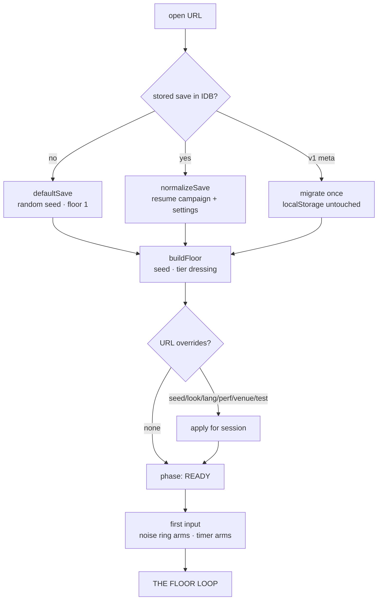
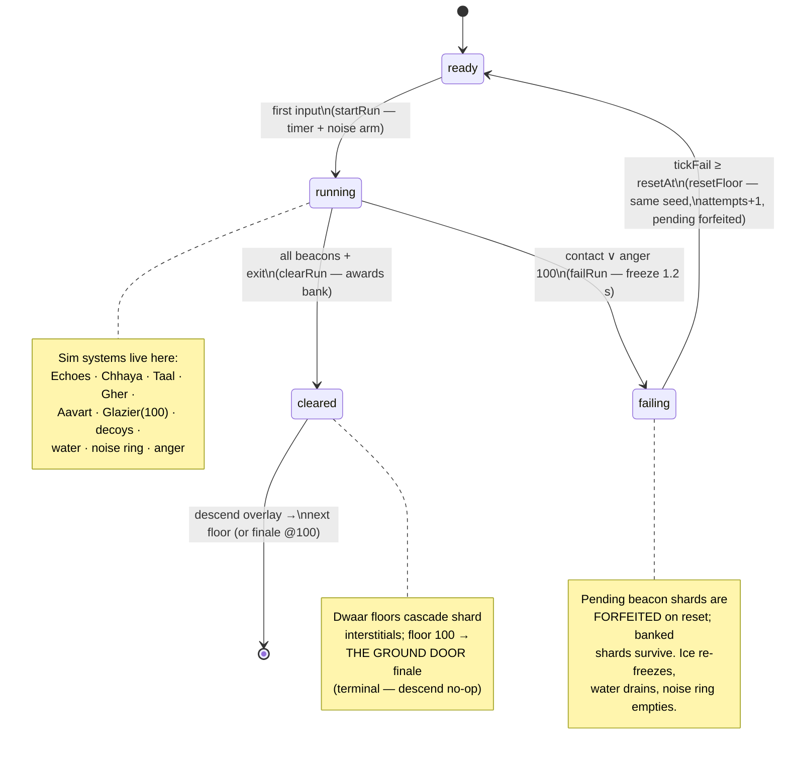
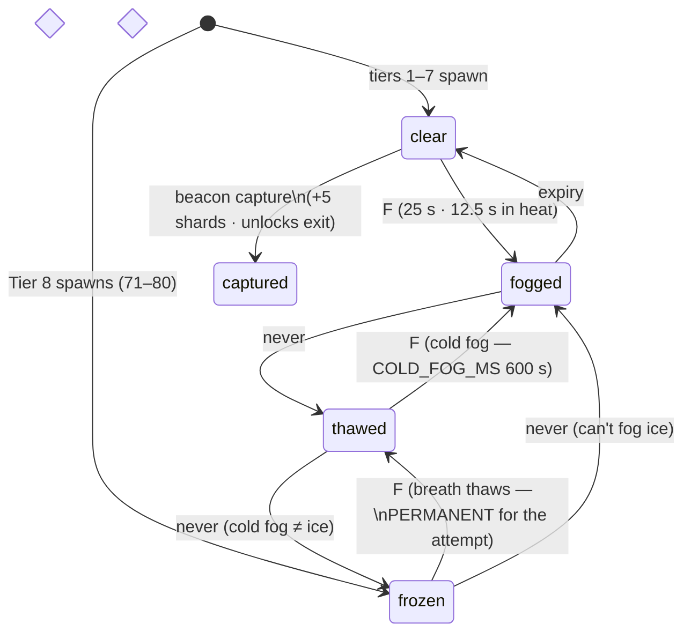
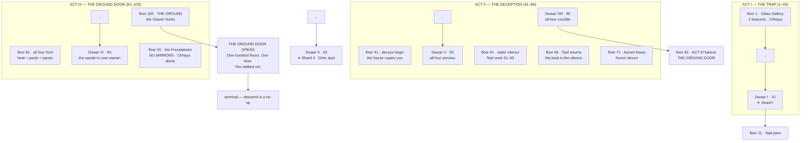
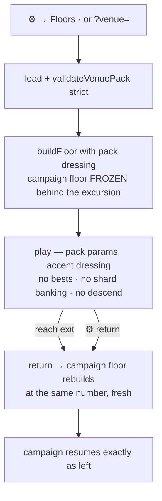
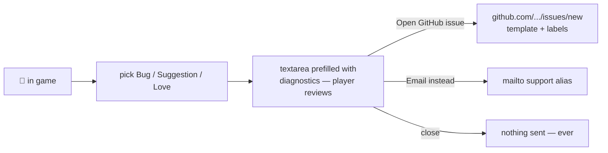

<!-- SPDX-License-Identifier: Apache-2.0 -->

# Workflows — the state model in motion

The normative registry of every machine lives in [STATE_MACHINES.md](STATE_MACHINES.md).
This document is the *motion* picture: how those machines chain together into the
end-to-end journeys a player (and the house) actually walks. Mermaid renders natively
on GitHub; [atlas.html](atlas.html) renders the same model animated.

---

## 1. Session workflow — open → play → leave → return



The boot chain is `(await idbGet()) ?? migrateFromMetaV1() ?? defaultSave()` — the
order is the whole policy: IDB is truth, v1 migration is one-time and leaves
localStorage untouched, defaults are the floor. URL parameters win over the save
for this session only.

---

## 2. The floor loop — the master machine

`GamePhase` (owner: `src/game/floorRun.ts`) is the machine every other system reads.



**Workflow rules the diagram implies**

| Rule | Where |
|------|-------|
| Movement, senses, contact, noise — everything — is gated on `active(phase)` (ready ∥ running) | `main.ts` sim gate |
| A same-frame fail+clear cannot happen: `clearRun` on a failed phase is a no-op returning the same reference | `floorRun.ts` (pinned by reference-identity test) |
| The timer, and therefore the Tier-5 water, is pinned to `failedAt`/`clearedAt` — the HUD clock can never tick on a corpse | `floorRun.ts:runElapsedMs` |
| Reset is same-seed by design: the maze is knowledge, and knowledge is the game | `main.ts:resetFloor` |

---

## 3. Mirror-pane workflow — the verb, per tier

`MirrorVisual` (owner: `src/game/frost.ts`) is the pane-level machine. The *verb*
routing differs by tier:



**Workflow consequences**

| Tier | The F verb means | The economy |
|------|------------------|-------------|
| 1–7 (glass) | fog → eye closes 25 s (12.5 s in heat) | fog is temporary cover |
| 8 (frozen) | frozen → **thaw** = live eye + 10 m lure; thawed → **fog** = permanent blind | every pane is a switch you set once |
| 9 (apex) | heat returns AND glass spawns clear | fog evaporates in 12.5 s while all four hunt |

Captured beacons are terminal (unlocks the exit); true mirrors are never frostable;
silvered doors and the water pools have their own machines (DoorPhase; ripple TTL).

---

## 4. The descent workflow — 100 floors, three acts

`Campaign` (owner: `src/game/campaign.ts`) is pure data + three transitions.



**Sentinel rotation (shipped gates, `campaign.ts` presence fns)**

| Warden | Walks | Rests |
|--------|-------|-------|
| Chhaya | 1–100 | never |
| Taal | 11–50 · 66–70 · 80–90 | 51–65 · 71–79 · 91–100 |
| Gher | 21–40 · 50–60 · 70 · 81–90 | 1–20 · 41–49 · 61–69 · 91–100 |
| Aavart | 31–40 · 50–60 · 71–90 | 1–30 · 41–49 · 61–70 · 91–100 |
| Decoys (the house) | 41–90 | 1–40 · 91–100 |
| The Glazier | 100 | 1–99 |

---

## 5. Persistence workflow — mutate → debounce → flush

```mermaid
flowchart LR
    M[any mutating action\nmode · mute · look · hint buy\nclear · descend · tier · playAgain] --> P[persist()\ndebounce 250 ms]
    P --> W[(IndexedDB\nsave v2 — validated on read)]
    M -- irreversible:\nclear · descend · tier\nimport · playAgain · daily --> PF[persist flush\nimmediate write]
    IMP[📂 import] --> V[validateSave strict] -- valid --> W2[(IDB put)] --> R[location.pathname reload]
    V -- invalid --> RJ[refused — never executed]
    EXP[💾 export] --> F[single JSON file\nplayer-owned]
```

The old `localStorage` meta v1 is migrated **once**, left untouched forever after,
and only read when IDB is empty — the ordered chain is the whole compatibility story.

---

## 6. Venue excursion workflow — a floor that never touches the campaign



Heat is explicitly gated out of venues (`heatActiveFloor() = venue === null && heatOn(...)`)
— the demo is dressed tier-one and stays tier-one, whatever the campaign floor.

---

## 7. Feedback workflow — the player owns the send



Nothing auto-sends. The diagnostics block contains game state only (version, seed,
floor, quality, language, error ring) — no personal data beyond the player agent.

---

*Normative machine registry: [STATE_MACHINES.md](STATE_MACHINES.md). Catalog:
[USE-CASES.md](USE-CASES.md). Animated: [atlas.html](atlas.html).*
